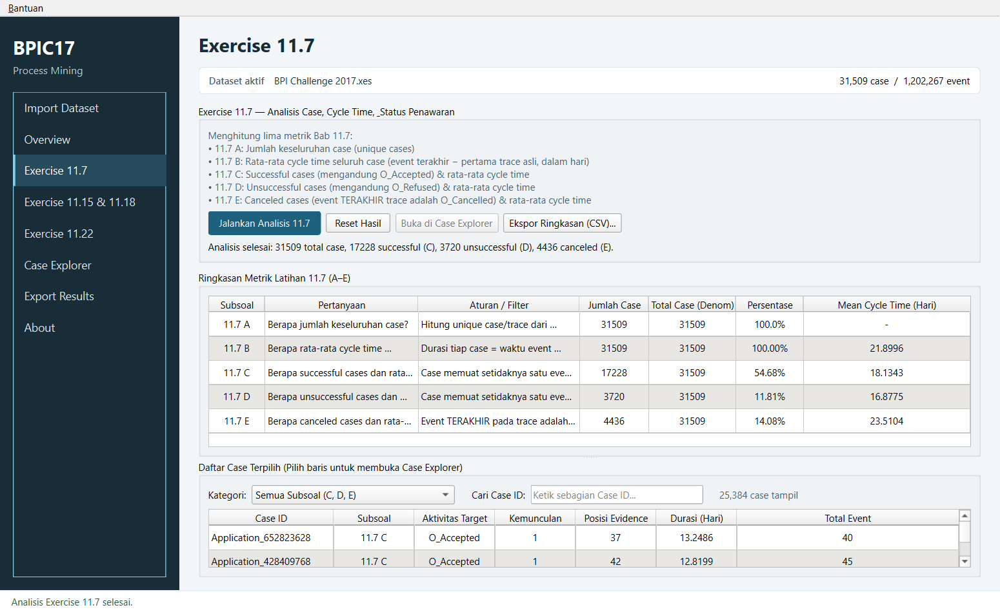

# BPIC17 Process Mining

Aplikasi desktop untuk proyek kelompok Data Mining Tahap 1. Aplikasi ini membaca riwayat proses pengajuan pinjaman dari dataset **BPI Challenge 2017 (BPIC17)** dan menjawab delapan butir latihan tentang durasi case, hasil penawaran, pengulangan pemeriksaan fraud, dan urutan event. Setiap hasil dihitung dari file XES yang dipilih. Case Explorer menampilkan trace asli beserta event yang menjadi bukti, dan hasilnya dapat diekspor ke CSV.

Dalam aplikasi ini, **case** adalah satu pengajuan pinjaman, **event** adalah satu kejadian pada pengajuan tersebut, dan **trace** adalah seluruh event pada satu case sesuai urutan aslinya. PM4Py membaca XES dan PySide6 menyediakan antarmuka desktop.

[](docs/screenshots/03_exercise_117.png)

[Persiapan Windows](#persiapan-di-windows) · [Demo langsung](#demo-langsung) · [Pengujian](#pengujian) · [Laporan dan screenshot](docs/test_report.md)

## Persiapan di Windows

### 1. Siapkan aplikasi

Pasang Git dan Python 3.13, lalu jalankan perintah berikut di PowerShell. Jika repositori sudah dikloning, buka foldernya dan mulai dari pembuatan virtual environment.

```powershell
git clone https://github.com/hanifihsann/BPIC17_Process_Mining.git
Set-Location .\BPIC17_Process_Mining
py -3.13 -m venv .venv
.\.venv\Scripts\python.exe -m pip install -r requirements.txt
```

Versi yang dipakai saat audit adalah Python 3.13, PySide6 6.11.3, PM4Py 2.7.23.13, dan pandas 2.3.3. Versi yang terpasang bisa diperiksa melalui **Bantuan → About**.

### 2. Siapkan dataset

Gunakan XES yang ditetapkan dosen atau unduh **BPI Challenge 2017 versi 1**, event log pengajuan pinjaman yang diterbitkan Boudewijn van Dongen (2017) dengan DOI `10.4121/uuid:5f3067df-f10b-45da-b98b-86ae4c7a310b`. Dataset disimpan lokal. [Rekaman dataset 4TU](https://data.4tu.nl/articles/_/12696884/1) · [Unduh arsip XES](https://data.4tu.nl/file/34c3f44b-3101-4ea9-8281-e38905c68b8d/f3aec4f7-d52c-4217-82f4-57d719a8298c)

Jika sudah memiliki file `.xes`, gunakan file tersebut langsung. Untuk arsip `BPI Challenge 2017.xes.gz`, buat folder `data` dengan perintah berikut.

```powershell
New-Item -ItemType Directory -Force .\data | Out-Null
```

Simpan arsip unduhan di `data`, lalu jalankan perintah ekstraksi di bawah. Lewati langkah ini jika file hasil sudah tersedia.

```powershell
@'
import gzip
from pathlib import Path
from shutil import copyfileobj

folder = Path("data")
with gzip.open(folder / "BPI Challenge 2017.xes.gz", "rb") as archive:
    with (folder / "BPI Challenge 2017.xes").open("xb") as xes:
        copyfileobj(archive, xes)
'@ | .\.venv\Scripts\python.exe -
```

### 3. Buka aplikasi

```powershell
.\.venv\Scripts\python.exe main.py
```

## Demo langsung

Sebelum presentasi, ekstrak dataset dan siapkan folder tujuan untuk menyimpan CSV. Angka berikut adalah hasil verifikasi pada **BPIC17 versi 1**. File XES lain akan menghasilkan angka sesuai isinya.

| Langkah | Aksi di aplikasi | Yang ditunjukkan |
|---|---|---|
| 1. Impor dan validasi | **Import Dataset → Pilih file XES**, lalu pilih `BPI Challenge 2017.xes`. Tunggu status **siap digunakan**. | Dataset aktif, atribut yang tersedia, **31.509 case** dan **1.202.267 event**. |
| 2. Overview | Buka **Overview**. Gulir ke tabel durasi dan cari satu Case ID bila perlu. | Rentang waktu, frekuensi aktivitas, dan rata-rata durasi **21,8996 hari**. Durasi dihitung dari timestamp event terakhir dikurangi event pertama pada trace asli. |
| 3. Exercise 11.7 | Buka **Exercise 11.7 → Jalankan Analisis 11.7**. | A dan B merangkum jumlah case dan durasi. C memilih trace yang memuat `O_Accepted`, D memilih trace yang memuat `O_Refused`, dan E memilih trace yang berakhir dengan `O_Cancelled`. |
| 4. Exercise 11.15 dan 11.18 | Buka **Exercise 11.15 & 11.18 → Jalankan Analisis**. Pindah antara kedua tab hasil. | **13 case** memiliki minimal dua event fraud berstatus `complete`. Di antaranya, **3 case** memiliki minimal dua event tersebut oleh resource yang sama. |
| 5. Exercise 11.22 | Buka **Exercise 11.22 → Jalankan Analisis**. | **902 dari 31.509 case (2,862674%)** memiliki `O_Cancelled` sebelum `O_Accepted` dalam trace yang sama. Event lain boleh berada di antaranya. |
| 6. Bukti event | Pada hasil 11.22, klik dua kali baris `Application_428409768`. Di **Case Explorer**, gulir ke kedua event yang disorot. | Trace lengkap berisi 45 event. `O_Cancelled` ada di urutan **#19** dan `O_Accepted` di **#43**. Untuk bukti 11.18, buka `Application_1221917431` dari tab 11.18 dan tunjukkan event **#60** dan **#74**, keduanya oleh `User_144`. |
| 7. Ekspor | Buka **Export Results → Ekspor Ringkasan ke CSV…**. Lalu pilih kategori **11.22** dan klik **Ekspor Daftar Case ke CSV…**. | Buka kedua file. Ringkasan berisi **8 baris jawaban** setelah ketiga menu latihan dijalankan. Daftar 11.22 berisi **902 baris case** beserta posisi dan timestamp bukti. |
| 8. Reset dan jalankan ulang | Kembali ke **Exercise 11.22**, klik **Reset hasil**, lalu **Jalankan ulang**. | Hasil muncul kembali dari dataset aktif yang sama dan jumlahnya tetap 902 case. |

Case Explorer menampilkan nomor urut mulai dari **1**, sedangkan kolom **Posisi Evidence (0-based)** di CSV dimulai dari **0**. Jika tombol ekspor belum aktif, jalankan latihan yang sesuai dengan kategori yang dipilih. Impor file baru yang berhasil mengosongkan hasil sebelumnya.

Hasil lengkap 11.7 A–E, perbandingan dengan materi, dan contoh bukti ada di laporan. Mean 11.7 D dan E dikonfirmasi dengan hitung ulang langsung dari timestamp XES karena angkanya berbeda dari slide. [Laporan audit dan screenshot bukti](docs/test_report.md)

## Pengujian

```powershell
.\.venv\Scripts\python.exe -m unittest discover -s tests -v
.\.venv\Scripts\python.exe -m tests.verify_bpic17 ".\data\BPI Challenge 2017.xes"
```

Audit terakhir mencatat **76 tes lulus**. Perintah kedua menjalankan alur GUI pada BPIC17 asli, memeriksa delapan jawaban serta evidence, membaca kembali CSV, dan mengulang analisis. Sesuaikan path XES bila file disimpan di folder lain. Untuk menyimpan screenshot baru tanpa menimpa bukti di repositori, tambahkan `--screenshots .\data\screenshots`. [Matriks pengujian](docs/test_matrix.md)

## Struktur dan kontribusi

| Penanggung jawab | Bagian |
|---|---|
| Anggota 1 | Impor, validasi, dan overview di `modules/data_loader.py`, `modules/overview.py`, dan `gui/import_overview_page.py` |
| Anggota 2 | Exercise 11.7 A–E dan ekspor CSV di `modules/exercise_117.py`, `modules/export_csv.py`, dan panel terkait |
| Anggota 3 | Exercise 11.15/11.18 di `modules/exercise_115_118.py` dan panel terkait |
| Anggota 4 | Exercise 11.22, Case Explorer, dan matriks pengujian di `modules/exercise_1122.py`, `modules/case_explorer.py`, dan panel terkait |
| Anggota 5 | Integrasi desktop di `main.py`, `gui/main_window.py`, `gui/app_state.py`, `gui/workers.py`, dan `gui/widgets/` |

Panel berbagi satu log aktif melalui `AppState`. Impor, pengindeksan Case Explorer, analisis, dan ekspor berjalan di worker agar navigasi tetap bisa digunakan selama pemrosesan.
